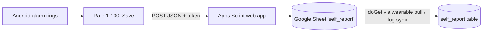

# CLAUDE.md

This file provides guidance to Claude Code (claude.ai/code) when working with code in this repository.

## Daily morning convention

When the user opens a session in this directory and says **"pull data"**, **"morning pull"**, **"fetch yesterday"**, or any obvious variation, do all of the following in one shot:

0. **First, remind the user to log today's feeling if they haven't already**, either on the phone (the Morning Log alarm app, see "Morning Log phone app") or with `uv run wearable log`. The subjective 1–100 readiness must be entered *before* any device data is shown, otherwise the rating is anchored on what the wearables already concluded. If the user mentions they've already logged, skip this. `wearable pull` syncs phone scores automatically (`self_report` line: OK / SKIP / FAIL; it never prints the scores themselves).
1. Run `uv run wearable pull --date today --device whoop` **and then** `uv run wearable pull --date yesterday --device whoop`. **Whoop only (owner's decision, 2026-11-09): the personal-recovery experiment uses Whoop plus the owner's feelings, not Fitbit or Oura.** Don't pull, report, or chase failures for `google_health`/`oura`, and don't nag about the Google re-auth, unless the owner brings them back. Both pulls are required:
   - **`--date today`** pulls *last night's* sleep. Every device labels a sleep with the **wake-up date**, so a sleep slept on day D−1 evening → day D morning is stored under `date=D` (today). Without this pull, the morning user can't see how they slept.
   - **`--date yesterday`** finalizes yesterday's activity row (steps, active calories), which only fully populates after midnight local once devices upload the prior day's totals.
2. Report Whoop's status (OK / FAIL) for **both** days and the key metrics from each successful row: today's `total_sleep_minutes`, `sleep_score`, `readiness_score`, and `hrv_ms`. The feeling score has already been logged by then, so it's fine to show it beside Whoop's recovery.
3. If any device fails, peek at `raw_payloads` for that device-date to see whether it's a transient API issue or a response-shape change we need to chase — `sqlite3 data/wearable.db "SELECT endpoint, substr(payload, 1, 400) FROM raw_payloads WHERE device='X' AND date='YYYY-MM-DD' ORDER BY id DESC"`.
4. If the user wants more, suggest `uv run wearable recovery scores` or, once there are ≥28 feeling days, `uv run wearable recovery tune`.

Don't ask for permission to do step 1. The user has set up daily morning runs as a known recurring task; the explicit phrase is the consent.

## What this is

A personal, single-user (the project owner is the only user) pipeline that pulls daily health metrics from three wearables — **Oura Ring 4**, **Whoop 5.0**, and **Google Fitbit Air** — into one normalized local SQLite database, so each device's measurements of the same day can be compared honestly. Local-first; not a product for other users.

The full original spec is in `wearable-pipeline-claude-code-prompt.md` — read it before making non-trivial decisions, especially around API choices and the data model.

## Commands

```bash
uv sync --extra dev                              # runtime + dev deps (httpx, pydantic, typer, pytest, respx)
uv sync --extra dev --extra analysis             # also install pandas + scipy for `wearable analyze`
uv run pytest                                    # run the full test suite (~56 tests)
uv run pytest tests/test_oura_client.py          # one file
uv run pytest tests/test_orchestrator.py -k retry  # one test by name match

uv run wearable init                             # create the SQLite db and apply pending migrations
uv run wearable log                              # interactive: prompt for 1–100 readiness + optional Fitbit readiness
uv run wearable log 70 --fitbit-readiness 48     # one-shot: log subjective=70 and manual Fitbit readiness=48
uv run wearable log-inbox                        # write the phone-inbox Apps Script (token filled in) + deploy steps
uv run wearable log-sync                         # pull Morning Log phone scores into self_report (pull does this too)
uv run wearable auth whoop                       # interactive OAuth → writes WHOOP_REFRESH_TOKEN to .env
uv run wearable auth google                      # interactive OAuth → writes GOOGLE_HEALTH_REFRESH_TOKEN to .env
uv run wearable pull --date yesterday            # pull all devices that have credentials
uv run wearable pull --date 2026-06-12           # pull a specific day
uv run wearable pull --date today --device whoop # only some devices (repeatable --device); others not pulled or counted
uv run wearable backfill --since 2026-05-23      # walk every day from --since to yesterday
uv run wearable backfill --since 2026-05-23 --skip-existing  # idempotent re-run, skip complete days
uv run wearable analyze --since 2026-05-23       # Spearman rank correlation across device pairs
uv run wearable hr-import-whoop --date today     # per-sample (6s) Whoop workout HR -> hr_sessions
uv sync --extra garmin                           # install the Garmin Connect client
uv run wearable auth garmin                      # one-time SSO login (prompts MFA), caches tokens ~1yr
uv run wearable hr-import-garmin --session <id>  # merge Garmin activity HR into a BLE session
uv run wearable hr-import-fitbit --session <id>  # merge Fitbit intraday (~2s) HR into a BLE session
uv run wearable hr-swim --date 2026-08-07        # SWIMS: one-shot API-only session (Garmin+Whoop; Fitbit no longer worn)

uv sync --extra viz                              # install Streamlit + pandas/scipy for the UI
uv run wearable viz                              # launch the Streamlit dashboard at http://localhost:8501
uv run wearable viz --port 8765                  # ...or pick a different port

uv run wearable recovery explain                 # fit a Whoop recovery replica, show weights + HRV/sleep share
uv run wearable recovery scores --scale sleep=2  # daily table: whoop / replica / re-weighted / personal / feeling
uv run wearable recovery tune                    # tune to `wearable log` feelings (needs ≥28 days), walk-forward test
```

`wearable pull` exit codes: 0 = all configured devices succeeded; 2 = partial failure; 1 = no configured devices or all failed. Logs go to stderr (INFO+) and to `data/logs/wearable.log` (DEBUG+, rotating).

There is no separate lint/format step configured yet — add one (ruff is a reasonable default) when the codebase grows enough to need it.

## Critical facts that override training data

These APIs are new or recently changed; do not trust training-data memory for them. Re-check the official docs before writing or modifying a client.

- **Fitbit Air uses the Google Health API** at `https://health.googleapis.com/v4/`, **not** the legacy Fitbit Web API (which is being deprecated September 2026). Do not write code against the Fitbit Web API.
- For Google Health, keep the OAuth consent screen in **testing mode** with the owner added as a test user. All required scopes are "Restricted" — testing mode is what avoids the full CASA security review for a single-user app.
- **Pull each device from its own API.** Do NOT use Google Health's Reconciled Stream or its Oura/Apple ingestion. The point of this project is to compare each device's independent numbers.
- **Whoop's data model is cycle-based, not calendar-day**: sleep cycles run sleep-to-sleep, recovery finalizes after the sleep cycle completes, day strain finalizes after midnight. When mapping into `daily_metrics`, pick a single deterministic rule for which calendar date a cycle belongs to (typically the wake-up date) and document it where you implement it.
- **Oura uses a personal access token** for single-user apps — use that, not the full OAuth flow.
- **All three APIs are daily-batch, not real-time.** Yesterday's complete data appears next morning after the device syncs. The architecture is a scheduled morning pull, not streaming ingestion.

## Architecture (the parts you need multiple files to see)

**Layered, with a strict raw-first storage rule.** Every device client returns a `FetchResult = (DailyMetrics, list[RawPayload])`. The caller (CLI/orchestrator) writes the `raw` entries to `raw_payloads` **before** upserting `metrics` into `daily_metrics`, all in a single transaction. This guarantees source data survives even if a mapping is wrong — the database, not in-memory data, is the source of truth.

- `clients/base.py` defines the `WearableClient` Protocol: `device: str` + `fetch_day(day) -> FetchResult`. Each device (`oura.py`, `whoop.py`, `google_health.py`) implements it. Adding a fourth device = new file in `clients/` + new `Literal` member in `models.Device`.
- Clients are storage-agnostic (no sqlite import). They build `RawPayload` entries during the fetch and emit them alongside the normalized `DailyMetrics`.
- `models.DailyMetrics` is the normalized shape (Pydantic v2). One row per `(date, device)`. Fields a given device does not expose stay `None` — never substitute zeros or device defaults; that destroys the comparison signal.
- `storage.upsert_daily_metrics` does `ON CONFLICT(date, device) DO UPDATE` so re-pulls overwrite cleanly. `storage.write_raw_payload` is append-only — never delete or upsert raw rows.
- `db.migrate` applies any `migrations/*.sql` files not yet present in `schema_migrations`, in lexical order, each in its own transaction. To add a schema change: drop a new `NNNN_description.sql` file in `migrations/` — do not edit prior migrations.
- `config.load_settings` reads `.env` (via python-dotenv). Missing values come back as `None`, not exceptions — clients decide whether they have what they need. Never log or echo token values.
- `cli.py` (typer) is the only entry point users invoke directly. Commands: `init`, `auth <device>`, `pull --date`, `backfill --since`. `auth`/`pull`/`backfill` are stubbed until their respective phases land.

### The schema is SQLite-now, Postgres-later

- Dates are stored as ISO-8601 TEXT (`YYYY-MM-DD`), timestamps as ISO-8601 TEXT in UTC, raw payloads as TEXT JSON. This ports to Postgres with minimal changes (raw payload column becomes JSONB).
- Don't introduce SQLite-specific types or rely on `ROWID` semantics.

### Cross-device comparison rule

**`strap` and `garmin` are ONE sensor, not two devices.** `STRAP_BLE_ADDRESS` is the Garmin HRM chest strap, so the live BLE `strap` series and the `garmin` series imported from Garmin Connect are the same physical sensor arriving by two transports. Their agreement checks the import pipeline's parsing and time-alignment — it is **not** a cross-device accuracy result, and counting both as independent devices double-counts one sensor. `capture/compare.py:SAME_SENSOR_PAIRS` encodes this and `hr-compare` labels the pair as a transport check. The genuinely independent comparisons are Whoop and Fitbit against the Garmin strap.

**Never average `*_score` fields across devices.** Each device's 0–100 score uses a proprietary scale and algorithm — averaging them is meaningless. The intended comparison is **Spearman rank correlation** on per-device score series (planned for Phase 6's analysis script). When in doubt, prefer raw physiological values (HRV, RHR, total sleep minutes) over device scores for any comparison.

## Daily automation

**Installed and verified 2026-11-09** as a launchd agent on this Mac. It runs `scripts/morning-pull.sh` daily at **9:30 AM local**, 30 min after the owner's 9:00 Morning Log alarm, so the day's feeling score is already on the phone. The script `cd`s to the repo root (`.env` and `data/wearable.db` resolve relative to cwd) and runs both pulls with `--device whoop`: `--date today` for last night's sleep and `--date yesterday` for yesterday's finalized activity (see "Daily morning convention"). Fitbit and Oura are excluded for the personal-recovery experiment, so a healthy run exits 0. Each pull also syncs phone scores into `self_report`.

- **Plist:** `~/Library/LaunchAgents/com.stingrayyee.wearable-daily-pull.plist`. `WorkingDirectory` is this repo. `ProgramArguments` is `/bin/sh scripts/morning-pull.sh` (absolute path). stdout and stderr go to `data/logs/launchd.log`. `RunAtLoad` is false.
- **`uv` is at `~/.local/bin/uv`** on this Mac, not `/opt/homebrew/bin/uv`. The script defaults to that path (override with `UV=`); launchd's minimal `PATH` can't find it otherwise.
- **Why launchd, not cron:** `StartCalendarInterval` fires at the **next wake** if the laptop was asleep at 9:30, whereas cron silently skips the run.

```bash
launchctl bootstrap gui/$(id -u) ~/Library/LaunchAgents/com.stingrayyee.wearable-daily-pull.plist  # load
launchctl print gui/$(id -u)/com.stingrayyee.wearable-daily-pull | grep -E 'state|last exit'      # status
launchctl kickstart gui/$(id -u)/com.stingrayyee.wearable-daily-pull                               # run now
launchctl bootout gui/$(id -u)/com.stingrayyee.wearable-daily-pull                                 # unload
```

`last exit code` is the second pull's exit status: 0 all OK, 2 partial failure (e.g. an expired Google token), 1 nothing succeeded. The project previously lived at `/Users/xinruiyi/Documents/wearable_devices_datapipeline` on another machine; that job does not exist here.

### Notes & gotchas

- **Working directory matters.** `scripts/morning-pull.sh` `cd`s to the repo root itself (and the plist also sets `WorkingDirectory`). Without that, `dotenv` doesn't find `.env` and the database goes to the wrong place.
- **Logs**: the `wearable_pipeline` Python logger already writes to `data/logs/wearable.log` (rotating, 10 MB × 5). `data/logs/launchd.log` captures the job's own stdout/stderr, which is useful for `uv` errors or environment failures.
- **Token rotation**: Whoop rotates refresh tokens on every call. The CLI uses `TokenManager` which persists the rotation back to `.env`, so daily runs work indefinitely. If a refresh ever fails 400 with `invalid_grant`, re-run `wearable auth whoop`. Same for Google, but on a **fixed 7-day clock, not an idle timer**: while the OAuth consent screen is in **testing** mode, Google expires every refresh token 7 days after issuance regardless of use — pulling daily does not keep it alive. Verified 2026-08-22: a token that worked Aug 21 returned `invalid_grant` / *"Token has been expired or revoked."* on Aug 23. It takes down `google_health` in the daily pull **and** `hr-import-fitbit`, so a swim/workout import failing at `oauth2.googleapis.com/token` means tomorrow's morning pull is already broken too. Fix: re-run `wearable auth google` (interactive). Publishing the app would lift the 7-day limit but triggers the CASA review this project deliberately avoids — so expect to re-auth weekly.
- **Network failures self-recover**: the orchestrator retries transient errors (429, 5xx, network timeouts) with exponential backoff. A flaky morning won't lose the day.
- **Catching up after a multi-day gap**: if you miss days (vacation, machine off), run `wearable backfill --since YYYY-MM-DD --skip-existing` — it walks every missed day and skips ones already complete.

## Build phases

The spec breaks the build into 6 phases. Phase 1 (scaffold) is done. The expectation is that each phase is verified by the owner before the next begins — don't leap ahead.

1. ✅ **Scaffold** — repo layout, deps, `.env.example`, schema + migration runner, empty client classes behind `WearableClient`.
2. ✅ **Oura client** — PAT auth, all four endpoints, raw + normalized rows; real-API verified.
3. ✅ **Whoop client** — shared `TokenManager` (rotates refresh tokens back into `.env`), interactive auth flow, cycle→wake-up-date mapping in `LOCAL_TIMEZONE`.
4. ✅ **Google Health (Fitbit Air) client** — Google OAuth in testing mode, list endpoints for daily HRV/RHR/respiratory/SpO2/sleep, `:dailyRollUp` for steps + active calories. Source-filter to Fitbit, never the reconciled stream.
5. ✅ **Orchestration** — `orchestrator.py` runs every configured device serially; per-device `try/except` for partial-failure tolerance; bounded retry on `httpx.TimeoutException`, `httpx.NetworkError`, and HTTP 429/500/502/503/504 with `Retry-After` honored; permanent 4xx propagates. Logs via stdlib `logging` to stderr + rotating file.
6. ✅ **Spearman analysis** — `wearable analyze` (requires the `analysis` extra: `pandas`, `scipy`). Per-pair Spearman rho + p across `{readiness_score, sleep_score, strain_or_activity_score, hrv_ms, resting_hr, total_sleep_minutes}`. Missing values are dropped per-pair, never imputed. No mean rho across pairs (would be meaningless).
7. ✅ **Streamlit dashboard** — `wearable viz` launches a single-page Streamlit app (`viz.py`) at `localhost:8501`. Reads `data/wearable.db` directly — no network. Sidebar filters (metric, date range, device subset), multi-device line chart for the selected metric, latest-day snapshot table, embedded Spearman correlation. `pd.DataFrame.applymap` was removed in pandas 3.0 — use `.map` (already done; flag if you see it creep back).
8. ✅ **Personal recovery model** — `wearable recovery {explain,scores,tune}` (`recovery.py`, needs the `analysis` extra). See "Personal recovery model" below.

## Personal recovery model

The owner's goal: copy Whoop's recovery algorithm, then reshape it around how they actually feel.

- **Features are "SD vs your own normal".** There are 11, all from Whoop's `daily_metrics` row: HRV, RHR, respiratory rate, skin temp, SpO2, sleep performance, sleep duration, sleep debt, sleep consistency, disturbances, and yesterday's strain. Each is z-scored against the trailing 30 days (min 14), **with the day itself left out** (`shift(1)`), so a day never counts toward its own baseline. HRV is log-transformed first. `prev_strain` is the previous *calendar* day's strain: `load_frame` reindexes to a gap-free daily calendar, so a missing row gives NaN rather than an older value. A model is `clip(intercept + Σ weight·z, 0, 100)`; each weight reads as "recovery points per 1 SD".
- **The replica is a linear approximation, not Whoop's algorithm.** Measured 2026-11-07 on 525 days with all 11 inputs: walk-forward MAE 5.4 pts, R² 0.79, rank corr 0.92 (the original 7 inputs gave 5.6 / 0.77 / 0.91). Influence shares: **HRV 61%**, all five sleep inputs 24%, respiratory rate 6%, SpO2 3%, yesterday's strain 3%, RHR 2%, skin temp 1%. HRV alone explains ~69% of the variance and sleep alone ~15%. With HRV held near normal, worst-quartile vs best-quartile sleep performance moves recovery only ~4 pts. That confirms the owner's suspicion that Whoop leans on HRV over sleep. Caveats:
  - Some of sleep's effect reaches recovery *through* HRV, so these shares understate sleep's total effect.
  - Small replica weights are not causal. The sleep inputs overlap (consistency and duration each correlate ~0.65 with sleep performance), so the replica gives consistency a slightly *negative* and disturbances a slightly *positive* weight. That only says how Whoop's score is best mimicked once performance is already in the model. Don't read the signs as "consistency is bad".
- **`--scale NAME=FACTOR`** multiplies replica weights. `sleep` is a group covering all five sleep inputs (`SLEEP_FEATURES`). It's a what-if knob, not a fit.
- **`tune` is ridge regression shrunk toward the replica**, with the intercept left free so a different personal scale costs nothing. `lam` reads as "the Whoop replica is worth `lam` days of feelings" (`inf` = keep Whoop's weights). `lam` is chosen by walk-forward validation, and the reported accuracies are **nested** walk-forward: each day is scored with a `lam` picked from earlier days only, so the comparison with Whoop is never scored on data it was fitted on. The comparison is personal model vs replica-weights-on-your-scale vs Whoop's own score linearly calibrated to feelings.
- **Data needed:** `MIN_FEELING_DAYS = 28` days that have a feeling and complete Whoop features. `self_report` was **empty** as of 2026-11-07: the 6/11–7/17 experiment's scores live in the old machine's (`xinruiyi`, possibly the Mac mini) `data/wearable.db`, which never came across with the git move. To recover them, export with `sqlite3 -header -csv data/wearable.db "SELECT * FROM self_report"` on that machine. Any rows logged before migration 0003 there are already ×10.
- Feelings must still be logged **before** viewing device data (`wearable log`); `recovery scores` shows device numbers, so run it after logging.

## Morning Log phone app

Daily feeling logging from an Android alarm clock, so the score is entered first thing, before any device data.



- **Why a Sheet inbox:** the laptop is often asleep or off the home Wi-Fi. The phone posts to an always-on Google Apps Script web app (`apps_script/self_report_inbox.gs`). The pipeline reads it back whenever it runs. The phone also keeps a local queue and retries until the script answers `{"ok": true}`.
- **Contract:** POST `{token, date (phone's local YYYY-MM-DD), readiness 1-100, logged_at ISO-UTC}`. GET `?token=&since=` returns `{ok, rows:[{date, readiness, logged_at}]}`. The sheet keeps one row per date (re-logging overwrites). Its date/time columns are forced to plain text, because Sheets otherwise silently converts `2026-11-08` into a Date.
- **Apps Script redirect quirk:** `/exec` executes, then answers **302** to `script.googleusercontent.com`, where the JSON lives. httpx needs `follow_redirects=True`. The Android client follows it manually as a GET (`HttpURLConnection` won't follow a cross-host redirect).
- **Secrets:** `SELF_REPORT_TOKEN` (random; generated into `.env`) and `SELF_REPORT_URL` (the `/exec` URL). Both are read from `.env` at **Android build time** into `BuildConfig`, so changing either means rebuilding the APK. `wearable log-inbox` writes the filled-in script to `data/self_report_inbox.gs` (gitignored); the committed template only has the placeholder.
- **Sync semantics (`self_report_inbox.sync`):** raw response archived to `raw_payloads` (device `self_report`) before rows are written. The phone's `logged_at` is preserved. `upsert_self_report` is **newer-wins** on `logged_at`, so syncing an old phone entry never clobbers a later `wearable log` correction. Default window: the last 60 days (`log-sync --all` for everything). A sync failure prints `FAIL` but never changes `wearable pull`'s exit code.
- **Redeploying the script:** use Manage deployments → edit → *New version*; a *new deployment* gets a new URL, which would mean rebuilding the APK.
- **Android app (`android/`, package `dev.wearable.morninglog`):** Kotlin, zero AndroidX or third-party dependencies, minSdk 26 / target 35. AGP 8.11.1 + Kotlin 2.2.21 + Gradle wrapper 8.14.3, a combination chosen from the official Kotlin compatibility table. Don't bump AGP past what the Kotlin plugin supports. The SDK comes from Homebrew's `android-commandlinetools` (`/opt/homebrew/share/android-commandlinetools`, referenced by gitignored `android/local.properties`). Build with `cd android && ./gradlew assembleDebug` and copy `app/build/outputs/apk/debug/app-debug.apk` to `android/morning-log.apk` (gitignored). Install over USB with `adb install -r` (adb is in the SDK's `platform-tools/`), or transfer the APK to the phone and allow "install unknown apps".
- **App behavior:** `setAlarmClock()` daily alarm, re-armed after it fires, after reboot and after app update. 9-minute snooze. The ringing screen *is* the log screen: a slider starting at 50, and Save stops the alarm. On Android 14+ the full-screen permission may need granting (the main screen shows a button). Unsent scores retry on app open, on each alarm, after Save, and every ~30 min while any remain.

## OAuth (Whoop, Google Health)

- Shared infra lives in `clients/_oauth.py`:
  - `TokenManager.get_access_token()` lazily refreshes via the configured `token_endpoint`. If the response contains a new `refresh_token` (Whoop **may** rotate them — undocumented), it's persisted back to `.env` via `update_env_var`.
  - `update_env_var(path, key, value)` does an atomic, comment-preserving in-place replace (writes to `.env.tmp`, `os.replace`s into place).
- Interactive flows live in `auth/{whoop,google}_flow.py`:
  - Spin up `http.server.HTTPServer` on `127.0.0.1:8765` to capture the OAuth callback.
  - `webbrowser.open` the authorize URL; the local server's single-request handler captures `code` + validates `state`.
  - `exchange_code()` is factored out as a pure function for testability.
- **Multi-pass commands must build clients ONCE and reuse them.** Whoop rotates its refresh token on every refresh and `TokenManager` persists the new one to `.env`, but the in-memory `Settings` keeps the stale token. If a single command makes two passes that each call `enabled_clients(settings)` (e.g. daily-metrics then workouts), the second pass builds a fresh `WhoopClient` from the stale `settings` and refreshes an already-consumed token → `400 invalid_grant`. Fix/pattern: call `enabled_clients` once and pass `clients=entries` to every pass. See `cli.py:pull`, which shares entries across `pull_one_day` and `pull_workouts`.

## Google Health quirks (mostly learned from live probing — docs are sparse)

- **Scopes confirmed via the v4 discovery doc** (`https://health.googleapis.com/$discovery/rest?version=v4`): `googlehealth.activity_and_fitness.readonly`, `googlehealth.health_metrics_and_measurements.readonly`, `googlehealth.sleep.readonly`. Refresh the discovery doc to update — `auth/google_flow.py:DEFAULT_SCOPES`.
- **OAuth prompts**: `access_type=offline` + `prompt=select_account consent` in the authorize URL. `offline` guarantees a refresh token; `select_account` forces the account picker so you can switch accounts during re-auth; `consent` re-shows the scope screen so a refresh token is reliably issued every time.
- **Prerequisite — the user's Google account must be linked to Google Health.** The Fitbit app on phone must be signed into the same Google account they consent with, and the Fitbit→Google Health sync must be set up at https://fitbit.google.com/auth/signup. If not, every endpoint returns 400 with `reason: ACCOUNT_NOT_LINKED`.
- **`filter` on `dataPoints:list` DOES work — but the field family must match the data type's shape.** (Corrected 2026-08-15 from the v4 discovery doc; the earlier "filters always fail" note was almost certainly the wrong field family, which is exactly what `INVALID_DATA_POINT_FILTER_DATA_TYPE_RESTRICTION` means.) Two rules: the field name is **snake_case** even though the data type id is hyphenated (`heart-rate` → `heart_rate`), and the family depends on the shape:
  - sample types (`heart-rate`): `heart_rate.sample_time.physical_time >= "2026-08-11T04:10:00Z"` (RFC-3339, or `.sample_time.civil_time` for ISO-8601 local)
  - interval types (`steps`): `steps.interval.start_time` / `.interval.civil_start_time`
  - daily summaries (`daily-heart-rate-variability`): `daily_heart_rate_variability.date >= "2026-08-11"`
  - sessions: `exercise.interval.civil_start_time`; sleep is special-cased to `sleep.interval.end_time` (and supports `OR`)

  Only `>=` and `<` are supported, joined by `AND`. Results come back **descending** by interval start — sort client-side. `fetch_day`'s existing unfiltered-then-filter-client-side approach still works and is left alone; `fetch_heart_rate` uses the filter because an unfiltered intraday pull would be thousands of points.
- **`pageSize` maxes at 10000**, not the 100 `_DEFAULT_PAGE_SIZE` uses (default is 1440 if unset). The exception is `exercise` and `sleep`, both capped at **25**. Intraday HR is dense — ask for the max there.
- **`dataPoints:dailyRollUp` POST body shape**: `range` uses fields `start` and `end` (NOT `startTime`/`endTime`), each a `CivilDateTime` proto = `{date: {year, month, day}}` (NOT a flat `{year, month, day}`). Wrong shape → `Cannot find field` 400.
- **Rollup value keys are different from per-sample keys.** `Steps` per-sample has `count`; `StepsRollupValue` has `countSum`. `ActiveEnergyBurned` per-sample has `kcal`; `ActiveEnergyBurnedRollupValue` has `kcalSum`. Don't conflate the two.
- **Google Health's `heart-rate` stream is MIXED — other vendors relay into it via Android Health Connect.** Verified live 2026-08-15 on the Aug 7 swim window: of 328 data points, only **39** were `platform: "FITBIT"`; the other **289** were `platform: "HEALTH_CONNECT"`, `recordingMethod: "UNKNOWN"`, `application.packageName: "com.whoop.android"` — Whoop's own 6 s-spaced samples arriving through Health Connect. Without `_is_fitbit_source` the "Fitbit" series would have silently absorbed Whoop's data and looked like it had full swim coverage. This is the concrete failure the "pull each device from its own API" rule prevents; never relax the source filter to "get more data".
- **The Fitbit Air does not measure HR while swimming — by design, not a bug or a settings problem.** Google documents it explicitly: *"Heart-rate tracking is enabled during your swim workout with your Google Pixel Watch 2, 3, and 4 only"* ([support doc](https://support.google.com/googlehealth/answer/14237015)). Confirmed on our own data 2026-08-15, and **the swim record's avg HR is worse than merely absent — it's inconsistent**: the Aug 10 `SWIMMING` record from `platform: FITBIT` has `averageHeartRateBeatsPerMinute: None`, but the Aug 7 one reports **80 bpm against Garmin's measured 115.8** — off by 36, almost certainly averaged from the handful of pre/post-swim samples. Never trust a Fitbit swim `avg_hr`; a present value is not a measured one. The same device's `WALKING` records that day report 93 and 96 normally. The raw sample stream agrees, and its *shape* is the proof: the surviving swim-window samples are not thinly spread, they sit in **two tight clusters at the very start and end with a ~1700 s hole between** (Aug 7: 16 samples in the first 33 s, 1721 s of nothing, 17 samples in the last 30 s; Aug 10: 11 / 1689 s / 9). Those clusters are **deck time** — after the Garmin activity started but before entering the water, and after climbing out but before stopping it — where the sensor is dry and tracks Garmin to within 0–5 bpm. In-water coverage is exactly zero.

  **The owner stopped wearing the Air for swims on 2026-08-22, so this is now mostly historical** — a swim is `garmin` + `whoop_api` only, and `hr-swim` reporting `fitbit: FAIL` or an empty merge is expected output, not a problem to chase. It still matters when reading the three archived swims (Aug 7 / 10 / 13), where any Fitbit-vs-X agreement stat was computed on dry deck seconds and means nothing about swimming: Aug 7 reports `fitbit_api vs garmin |Δ|=3.29, r=0.952` — Fitbit's best-looking number in the whole project, from n=76 of 1784 s, all of it out of the pool. **Don't chase this**: there is nothing to fetch, no toggle to flip, and third-party testing of the Air in open water measured a −10.9 bpm bias vs an ECG chest strap with limits of agreement −21.7/+41.7 ("fair to poor"), so even the sparse in-water values it does emit aren't trustworthy. Use Garmin for swim HR. The Air is still worn for **land** workouts, where it is genuinely good — see the Whoop-vs-Fitbit land result below.
- **Source filter**: real responses tag Fitbit data with `dataSource: {platform: "FITBIT"}`. `applicationDataSourceId` and other historical fields are empty. `_is_fitbit_source` keys off `platform == "FITBIT"`.
- **`dataPoints:reconcile` is the merged-source stream** — explicitly never call it. Use `:list` and filter `dataSource` client-side.
- **Per-sample intraday HR is the `heart-rate` sample data type** (distinct from `daily-resting-heart-rate`), implemented as `GoogleHealthClient.fetch_heart_rate(start, end)` and exposed as `wearable hr-import-fitbit`. Shape per the v4 discovery doc: `dataPoints[].heartRate.beatsPerMinute` (a **string**, like the other numerics) and `dataPoints[].heartRate.sampleTime.physicalTime` (RFC-3339). Source-filter to Fitbit as always — a Pixel Watch on the same account would otherwise contaminate the series. Lands as device **`fitbit_api`**, beside the live BLE `google_health` series.
- **Fitbit intraday cadence is ~2 s, not the ~5 s previously assumed** (verified live 2026-08-15: 2427 samples over a 4 h window, median gap 2.0 s, ~270 samples per 10 min sustained). Still short of Garmin's true 1 Hz, so report delivered spacing rather than assuming.
- **The Fitbit Air does not record HR while swimming — and that gap is the device, not the API.** Same 4 h probe: coverage is a steady ~270 samples/10 min before and after, then collapses to 8 / 0 / 39 across the three 10-minute blocks of a pool swim, with a single 1689 s gap exactly spanning it. `hr-import-fitbit` faithfully returns everything that exists; for swims nothing exists to fetch. **Use Garmin for swim HR** — don't re-probe this expecting the API to fill it in.
- **No Fitbit "Readiness" or "Sleep Score" in the v4 public API.** Confirmed empirically on 2026-06-22: searched every schema and property in the discovery doc — zero fields with `readiness`/`score` in their name. Probed 30+ candidate data type IDs (`daily-readiness`, `daily-readiness-score`, `fitbit-readiness`, `wellness-score`, `recovery-score`, etc.) — every one returns 400 "Invalid data type ID". The Google Health mobile app does display readiness (e.g. "48"), but it either uses an internal Google API not exposed to third-party OAuth clients, or computes the score client-side from raw inputs. Don't waste another session re-probing — `google_health.readiness_score` and `google_health.sleep_score` are permanently `None`. Same for `body_temp_deviation` and `skin_temp`.
- **`minutes` values come back as strings**, not ints — convert via `_int_or_none`. Same for `count`/`countSum`.
- **Per-session Fitbit workouts use the `exercise` data type** (NOT `activity`, `workout`, `session`, or any variant — those all return 400 "Invalid data type ID"). `fetch_workouts(since, until)` calls `GET dataTypes/exercise/dataPoints` with `pageSize=100` and filters client-side to Fitbit-source records whose start local-date falls within `[since, until]`. `provider_id` is the last path segment of the response `name` field (`name.split("/")[-1]`). `averageHeartRateBeatsPerMinute` in `metricsSummary` is a **string**, not a number — convert via `_to_float`. Calories are at `metricsSummary.caloriesKcal`. **Per-session max HR is not exposed** in the v4 API (only average HR and `heartRateZoneDurations` appear in `metricsSummary`), so `google_health` workouts always have `max_hr=None`.

## Whoop quirks (mostly learned from live probing — docs are sparse)

- **API is `/developer/v2/...` now.** `/developer/v1/cycle` still resolves for backward compat but `/developer/v1/recovery` and `/developer/v1/activity/sleep` return 404 — they only exist at v2.
- **The `offline` scope is required to get a refresh token.** Without it, the token endpoint returns only `access_token` + `expires_in`. Hardcoded in `auth/whoop_flow.py:DEFAULT_SCOPES`.
- **Refresh tokens are single-use and rotate on every refresh.** `TokenManager._refresh` persists the rotated token back to `.env`. **NEVER call the token endpoint directly with `httpx.post` for ad-hoc probes** — the rotation will be lost and the next refresh fails 400 (`invalid_grant`), requiring a full re-auth. If you must probe, instantiate a `TokenManager` and call `get_access_token()`.
- **`redirect_uri` matches `localhost` vs `127.0.0.1` strictly.** Whoop rejects mismatches with `invalid_request`. The `.env.example` ships with `127.0.0.1` to match the walkthrough.
- **Cycle → calendar day**: anchor on the sleep record whose `end` timestamp, converted to `LOCAL_TIMEZONE`, lands on the target day, and `nap == false`. The matching `recovery.sleep_id` and `cycle.id` pull the other two records. Centralized in `_pick_main_sleep` / `_end_local_date`.
- **Steps come from `cycle.step_count`**: a top-level cycle field, *not* under `score`. It wasn't in the API when the client was first written; it was found 2026-11-07, and Whoop serves it retroactively. It's present in archived raw payloads back to 2025-04-08, which let the stored rows be backfilled from `raw_payloads` with no API calls (558 of 584 days, the rest have no main sleep). The cycle runs wake-up to next sleep, so `steps` for date D is the waking day D, the same span as `strain_or_activity_score`. That differs from Google Health's midnight-to-midnight `steps`; keep it in mind when comparing.
- **Sleep detail + SpO2 (migration 0006):**
  - `spo2_pct` ← `recovery.score.spo2_percentage`
  - `sleep_consistency` ← `sleep.score.sleep_consistency_percentage / 100`
  - `sleep_disturbances` ← `stage_summary.disturbance_count`
  - `sleep_debt_minutes` ← `sleep.score.sleep_needed.need_from_sleep_debt_milli` (ms → min). That's only the *debt* part of sleep need; `baseline_milli`, `need_from_recent_strain_milli` and `need_from_recent_nap_milli` are left in the raw payload.

  All four were backfilled from `raw_payloads` on 2026-11-07 (557–558 days). Google Health fetches `daily-oxygen-saturation` but doesn't map it yet, so its `spo2_pct` stays NULL.
- **`active_calories` is synthesized** from `cycle.score.kilojoule` (kJ / 4.184) — Whoop reports total cycle calories (which includes BMR), so the synthesized value is much larger than Google Health's "active above resting" kcal. Document the difference when comparing.
- **Sleep durations are in milliseconds** (`_milli` suffix on the field name). Convert to minutes via `_milli_to_min` (`/ 60000`).
- **Total asleep = total_in_bed - total_awake** from `stage_summary` — Whoop doesn't expose a direct "total sleep" field at this level.
- **Workouts are at `/developer/v2/activity/workout`** (`clients/whoop.py:fetch_workouts`). Per-record: `sport_name`, `start`/`end`, `score.average_heart_rate`, `score.max_heart_rate`, `score.kilojoule` (→ kcal via `_kj_to_kcal`). Unlike Google Health, Whoop **does** expose per-workout `max_heart_rate`.
- **Pagination key asymmetry (verified live 2026-06-26):** the workout list response returns the cursor under `next_token` (snake_case), but the request query param to fetch the next page is `nextToken` (camelCase). Confirmed empirically: passing `next_token` as the param does NOT advance; `nextToken` does. `fetch_workouts` reads `body["next_token"]` and sends `params["nextToken"]` — both are correct, do not "fix" the asymmetry.

### Per-sample workout HR is NOT in the public API — use the internal endpoint

- **`/developer/v2` has no heart-rate time series at all.** The full v2 endpoint list is cycle / recovery / sleep / workout / user / partner; `workout.score` tops out at `average_heart_rate`, `max_heart_rate` and `zone_durations`. The member CSV data export is aggregate-only too. Don't go looking for a `step`/`samples` param on the public workout endpoint — there isn't one.
- **The web app's own HR graph is powered by an internal endpoint**, implemented in `clients/whoop_internal.py` and exposed as `wearable hr-import-whoop --date <D>`:
  ```
  GET https://api.prod.whoop.com/metrics-service/v1/metrics/user/{user_id}
      ?name=heart_rate&start=<iso_ms>&end=<iso_ms>&step=<s>&apiVersion=7
  -> {"values": [{"time": <unix_ms>, "data": <bpm>}, ...]}
  ```
- **It authenticates against the member's account login, not OAuth.** `POST /auth-service/v2/whoop/sign-in` with `{username, password}` → `access_token` (+ `user.id`, else `GET /auth-service/v2/user`). The developer OAuth token from `whoop.py` is rejected. Credentials are `WHOOP_USERNAME` / `WHOOP_PASSWORD` in `.env`. There's no documented refresh grant — on 401 the client just re-runs sign-in.
- **6 seconds is the retrospective floor.** `step` accepts 6 / 60 / 600 only; the web app never asks for anything else and Whoop quantizes server-side. **True 1 Hz Whoop HR exists only on the live BLE broadcast** (`capture/ble_hr.py`) and cannot be recovered after the fact — so `hr-import-whoop` reports the spacing actually delivered rather than the step requested. Don't promise "per-second" from this endpoint.
- **Keep it isolated from `clients/whoop.py`.** It's unofficial, undocumented and can change without notice; a break here must never take down the daily metrics pull. It deliberately does not implement the `WearableClient` protocol.
- **Two entry points.** `--date <D>` imports each stored Whoop workout that day into its own session id `<workout_start>-whoop` (the suffix can never collide with a live BLE session started the same second); it needs the `workouts` table populated, so it depends on OAuth via `wearable pull`. `--session <hr_session_id>` needs no OAuth at all — it takes an existing BLE capture's window and merges Whoop's stored series into that same session under device key **`whoop_api`**, sitting alongside (never overwriting) the live `whoop` BLE series. That's the one to reach for when comparing against the chest-strap baseline or filling an underwater BLE dropout.
- Re-importing either way is idempotent — `hr_samples`' PK is `(session_id, device, ts_utc)` and the bucket timestamps are deterministic, so `INSERT OR IGNORE` no-ops.
- `hr-compare` derives its `max_hold_s` from each series' observed median gap (`max(8, 2 × widest gap)`) so a 6 s (or coarser) imported series doesn't step off the end of `align_series`' 8 s default hold and render as an all-NaN column. BLE-only sessions are unaffected.
- **NEVER trust Whoop's swim HR at hard effort — it under-reads, and the error grows with intensity.** Verified 2026-08-18 on the first two API-only swim sessions and again 2026-08-22 (`whoop_api` vs `garmin` baseline). In water it runs |Δ|=5.4–8.6 bpm, **38–60%** within 5 bpm, r=0.756–0.925. Below ~165 bpm *on land* the same sensor is excellent (|Δ|=1.5–2.9, 84–97% within 5) — but that is an **intensity** bound, not a land/water one; it compresses on land too, see the next bullet. The error is not noise; it is one-directional compression of the top end (mean signed error, whoop_api − garmin, by Garmin bpm band):
  ```
  garmin bpm     90-100  100-110  110-120  120-135    135+
  Aug 7 swim      +0.23    +0.30    -4.87   -11.88  -24.31
  Aug 10 swim     +0.93    +0.52    -3.82    -9.70     n/a
  Aug 22 swim     -1.14    -4.89    -2.71    -5.68   -9.43   (135+ is only n=21)
  ```
  Above ~110 bpm the gap widens with effort in all three swims. Below 110 it is near-zero on Aug 7/10; Aug 22 reads mildly low there too, but on thin support (n=64 and 72), so treat the sub-110 cells as noise rather than evidence the floor moved. Aug 7's mean bias was −7.02 bpm with Whoop reading low on 77% of paired seconds. **Consequence: a Whoop swim *average* is roughly usable (108.8 vs Garmin's 115.8) but its peak/max HR and any hard-interval value are not** — that 7 bpm average error hides a −24 bpm error exactly where you would care. Use Garmin for all swim HR and treat `whoop_api` as a comparison series only. Unlike the Fitbit swim gap (a total absence, dry deck-time clusters only), this is real continuous in-water data that is simply wrong at intensity — so `n_overlap` looks healthy and will not warn you. **A milder-looking swim usually means an easier swim, not a better sensor.** Aug 22 scored |Δ|=5.39 / 60% / r=0.925 — the best swim numbers yet — only because 47% of it sat in 120–135 and just 21 s went above 135, where Aug 7 spent 760 s and 51 s. Compare band *exposure* before concluding anything improved.
- **Whoop's land accuracy is bounded by intensity too — it compresses above ~165 bpm on land, and drops out entirely under hard intervals.** The "excellent on land" figure above came from sessions that never exceeded 165 bpm. Verified 2026-08-20 (`20260821T020726Z-garmin`, 82 min, 42% of time >150, max 177): headline |Δ|=6.03, 71.8% within 5, r=0.873 — far worse than the 1.5–2.9 land norm. Restricting to seconds where the Garmin baseline was flat (≤5 bpm over 30 s) isolates true compression from 6 s-bucket transition lag, and the compression survives:
  ```
  garmin band   135-150  150-165  165-200     (stable seconds only)
  |Δ|              1.49     1.92     6.86
  within 5          97%      98%      70%
  ```
  So ~1/3 of the headline error (6.03 → 4.26) is genuine bucketing lag, but the top-end breakdown is the sensor. The Jul 31 elliptical agrees independently (BLE `whoop` vs `strap`: |Δ|=2.5–3.1 in every band below 165, then −5.53 / 35% within 5 above it). Whoop also **loses the signal for minutes at a time** under hard intervals — one 258 s stretch at −40.4 mean, −59 peak (Garmin 138–172 while Whoop read 111–135). Consequence: a Whoop max/peak HR is unusable at high effort **on land as well as in water**, and a hard-interval session is where Fitbit beats it (see below).
- **On a hard land workout the Fitbit Air outperforms Whoop — the usual ranking flips.** Same 2026-08-20 session: `fitbit_api` |Δ|=3.49, 84.9% within 5, r=0.955 vs `whoop_api` |Δ|=6.03, 71.8%, r=0.873. Fitbit wins on its ~2 s cadence handling fast transitions (vs Whoop's 6 s floor) and on never dropping out for minutes. But it is **not** uniformly better: on stable seconds in the 150–165 band Whoop is sharper (|Δ|=1.92 vs 6.31), and Fitbit fabricates peaks Whoop never does — an 86 s excursion reading +24.6 mean, peaking at **198 against Garmin's 169** (cadence lock, not physiology). Neither device's max HR is usable here: Fitbit overshot by 21, Whoop undershot. Use Garmin for any peak.
- **A swim needs no Whoop app logging.** `hr-swim` derives the window from the Garmin activity's own HR samples and the internal metrics endpoint is continuous 24/7, not activity-scoped — verified 2026-08-18 with a completely empty `workouts` table and full 6 s `whoop_api` coverage across all three stored swims. Logging the swim in the Whoop app adds only a `workouts` summary row, never samples.

## Garmin Connect (per-sample workout HR)

Garmin is the **only** source here that returns true per-second HR. Whoop's retrospective floor is a 6 s bucket and Google Health's is ~5 s; Garmin hands back the samples the device actually recorded. Implemented in `clients/garmin.py`, exposed as `wearable hr-import-garmin`.

- **Resolution is a device setting, not an API parameter.** "Every Second" recording gives 1 Hz; Garmin's default "Smart Recording" is variable and much sparser. Always report the delivered spacing (`series_rates`) rather than claiming 1 Hz.
- **`maxChartSize` silently downsamples.** `GET /activity-service/activity/{id}/details?maxChartSize=N` thins the series above `N` instead of erroring, so a long activity fetched at the 2000 default comes back quietly decimated. `_chart_size()` sizes it from the activity duration (1.25× headroom, capped at 60000). Pass `maxPolylineSize=0` — we don't want the GPS track, and it bloats the archived raw payload.
- **Detail metrics are positional.** `activityDetailMetrics[].metrics` is a bare array; `metricDescriptors[].metricsIndex` maps position → name (`directHeartRate`, `directTimestamp`), and **the layout varies by device and activity type**. Never hardcode an index — resolve from the descriptors every call. `_descriptor_index` prefers an exact key match, then falls back to a case-insensitive substring.
- **A hand-entered activity has no HR descriptor at all.** That's a legitimate answer, not an error — `_parse_details` returns `[]` and the CLI says so explicitly rather than failing obscurely.
- **Auth is Garmin Connect SSO, not OAuth.** `garminconnect>=0.3.10` does its own auth (`curl_cffi` TLS impersonation + rotating user agents) and **no longer depends on the deprecated `garth`** — don't reintroduce garth, its mobile auth flow is broken. Run `wearable auth garmin` once: it prompts for MFA and caches tokens in `GARMINTOKENS` (default `~/.garminconnect`, ~1 year). Later runs need no password, so `hr-import-garmin` stays non-interactive.
- `garminconnect` requires Python ≥3.12 while this project's floor is 3.11 — the `garmin` extra carries a `python_version >= '3.12'` marker so it doesn't make the project unresolvable on 3.11.
- **Garmin chest straps (HRM-Pro/HRM-Swim class) store HR internally while submerged** and upload afterwards, so a Garmin strap's Connect data covers underwater stretches that BLE physically cannot reach. When the same strap is also captured live over BLE as `strap`, the two series are the same sensor by different transports — expect near-identical values where both exist, and full coverage only from the API one.
- Same two entry points as `hr-import-whoop`: `--date` (own session per activity, id `<start>-garmin`) and `--session <id>` (merge into an existing BLE capture as device **`garmin`**, matching the activity by greatest time overlap). Garmin lists by *local* start date, so `--session` widens the query ±1 day to survive a session that straddles local midnight.

## Oura API gotchas (learned from Phase 2)

- **Don't query single-day windows.** `start_date == end_date` silently returns `data: []` even when records exist for that day, on all four endpoints (`/v2/usercollection/{daily_sleep,daily_readiness,daily_activity,sleep}`). The filter applies to a timezone-bearing timestamp, not the response's `day` field. Solution: always query `day-1 .. day+1` and post-filter to records where `data[].day == target.isoformat()`. This pattern is implemented in `clients/oura.py:fetch_day`.
- **`efficiency` is an integer 0..100**, not a 0..1 decimal — divide by 100 when mapping into `DailyMetrics.sleep_efficiency` (which stores 0..1). `clients/oura.py:_pct_to_unit` handles this.
- **Durations are in seconds** — convert to minutes for the normalized model (`_sec_to_min`).
- **Main sleep is the longest session.** Oura returns naps and partial sessions in `/sleep`; there's no native main-vs-nap flag. Pick `max(data, key=total_sleep_duration)` (`_longest_sleep`).

## BLE heart-rate capture

`capture/` (`ble_hr.py`, `compare.py`) is a separate, **BLE-only** subpackage —
it does not implement the `WearableClient` HTTP protocol used by `clients/`,
since it talks to devices directly over Bluetooth rather than a vendor API.

- Commands: `wearable hr-scan` (discover nearby BLE HR peripherals), `wearable
  hr-capture` (live multi-device capture into `hr_sessions`/`hr_samples`), and
  `wearable hr-compare <session_id>` (overlay chart + agreement stats; needs
  the `analysis` extra).
- Device BLE addresses live in `.env` as `WHOOP_BLE_ADDRESS` /
  `FITBIT_BLE_ADDRESS` / `STRAP_BLE_ADDRESS`, discovered via `hr-scan` —
  there's no vendor API for BLE peripheral discovery, so this is a manual
  one-time pairing step per device. `google_health` is the device key for
  Fitbit Air here too, same as the HTTP client.
- **The chest strap is the ground-truth baseline.** `STRAP_BLE_ADDRESS` is
  optional and uses device key `strap`. `hr-capture` records every configured
  BLE address concurrently (needs ≥2; `ble_hr.capture_session` already takes an
  arbitrary `{device: address}` and is partial-failure tolerant). When a
  `strap` device is present, `hr-compare` passes `baseline="strap"` to
  `compare.compute_stats`, which returns `{baseline, pairs}` — each wearable's
  agreement *against the strap* — instead of the legacy top-level single-pair
  keys. No baseline (or a pre-strap 2-device session) keeps the old flat shape.
  Adding another strap/reference = new `*_BLE_ADDRESS` in `config.py` + include
  it in the `candidates` dict in `cli.py:hr_capture`.
- **BPM only** — RR intervals / HRV are out of scope; the HR Measurement
  characteristic parser only extracts heart rate.
- **A device that disconnects mid-session keeps retrying for the rest of the
  session — it never permanently gives up while `stop_event` is unset.**
  `ble_hr.capture_session`'s `run_device` retries at a fast 1s interval for
  the first `reconnect_attempts` failures, then backs off to
  `retry_backoff_s` (default 10s) so a device that's genuinely unreachable
  for a long stretch (e.g. a swimmer out of BLE range underwater) doesn't
  hammer the BLE stack or spam logs — but it keeps trying, so a wall touch or
  resurfacing mid-swim picks the stream back up automatically instead of
  leaving that device dead for the rest of the session. The backoff sleep
  itself is interruptible (`asyncio.wait_for` on `stop_event`), so stopping a
  session never stalls waiting out another device's backoff.
- **BLE physically cannot reach a submerged/distant peripheral** — the
  retry logic above only recovers gaps near the surface (wall touches, flip
  turns); it can't fix genuine underwater dead zones. For full continuous-swim
  HR, the only path is a retrospective pull from Google Health API v4's
  `heart-rate` data type via `dataTypes/heart-rate/dataPoints:list` (distinct
  from the `daily-resting-heart-rate` type already used) — official,
  per-sample, ~5s median interval in practice — sliced to the workout's
  start/end window from `fetch_workouts`, since Fitbit stores that data
  on-device/cloud-side regardless of BLE range. **This is now implemented for
  all three** — `hr-import-whoop` (6 s), `hr-import-garmin` (true 1 s) and
  `hr-import-fitbit` (~5 s) each pull the device's own stored series for a
  window and merge it into the BLE session, covering the underwater stretch
  BLE physically could not. Garmin is the one to trust for swim HR: verified
  2026-08-15 on the Aug 10 swim at 1734 samples / 1.0 s over the full 28.9 min,
  agreeing with the BLE chest strap to |Δ|=1.78 bpm (r=0.91) where they
  overlap — same sensor, different transport.
- **Swim sessions: skip BLE entirely, use the API imports.** Measured across
  every swim captured so far, BLE dies within the first ~2.5 min and covers
  only 6–9% of the session (Aug 10: last sample at 148 s of 1730 s; Aug 12:
  106 s of 1738 s). Water absorbs 2.4 GHz far too fast for a submerged strap to
  reach the laptop, and the reconnect logic only recovers surface moments (wall
  touches, flip turns). Do NOT run `hr-capture` for a swim — use `wearable
  hr-swim --date <D>`, which builds the session from the Garmin activity (the
  only source with full underwater coverage) and merges the Whoop API series
  into it. Since 2026-08-22 a swim is **`garmin` + `whoop_api` only** — the
  Fitbit Air is no longer worn for swims (it records nothing underwater), so
  `hr-swim`'s Fitbit step failing or returning empty is expected, not a fault
  to investigate. BLE capture stays the right tool for **land** workouts,
  where it gives 1–2 Hz against the API's 1–6 s.
- **Fitbit only streams while its "Share Heart Rate" toggle is actively live**
  in the Fitbit/Google Health phone app, and it's a low-rate, contact-gated
  source — roughly 1 sample/2.5 s at rest, sometimes sparser on the wrist
  during motion — versus Whoop's steady ~1 Hz. `capture/compare.py` handles
  this by step-interpolating the sparser series onto a shared 1 s grid
  (holding the last value forward up to `max_hold_s`) and reports each
  device's effective Hz (`series_rates`) alongside the agreement stats, so a
  slow Fitbit rate is visible rather than silently smoothed away.
- Chart PNGs from `hr-compare` write to `data/hr_sessions/<session_id>.png` by
  default — under the gitignored `data/` directory, same as the SQLite DB and
  logs.
- Requires a one-time macOS Bluetooth permission grant to the terminal app
  (System Settings → Privacy & Security → Bluetooth) before `hr-scan` /
  `hr-capture` can see peripherals.
- Oura is out of scope for BLE capture — the ring does not broadcast live HR
  over BLE.

## Working norms

- Before writing or modifying a device client, fetch that device's current official API docs (endpoint shapes, scopes, auth steps). Training-data memory of these APIs is stale.
- Ask before assuming anything about credentials or environment.
- Keep changes small and scoped to the current phase so the owner can verify as you go.
- Never hardcode tokens. All secrets live in `.env`; `.env.example` is the committed template.
